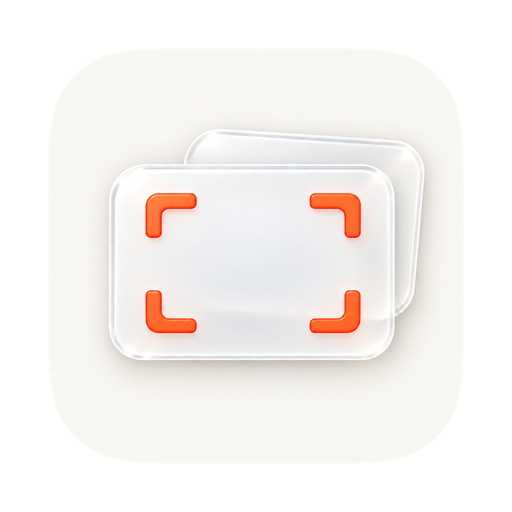
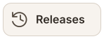
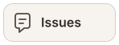
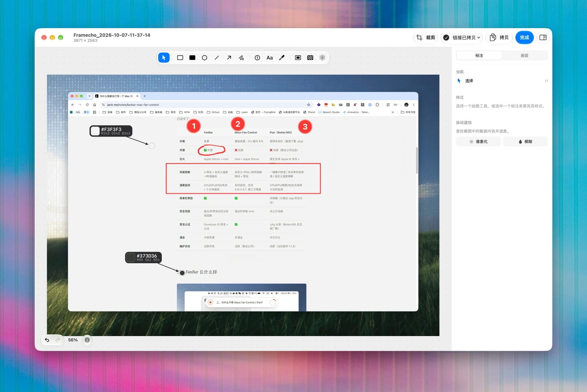
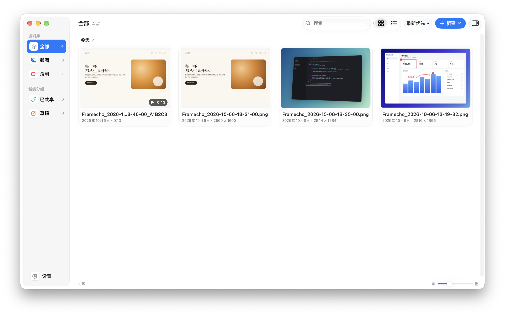
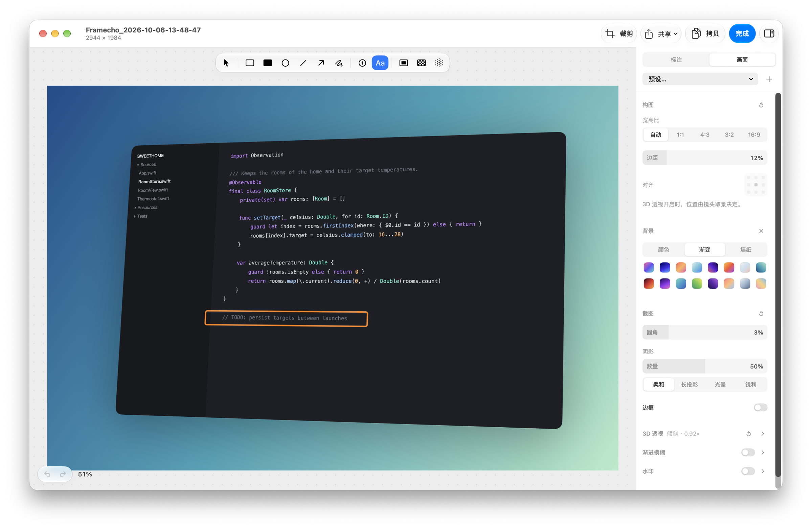
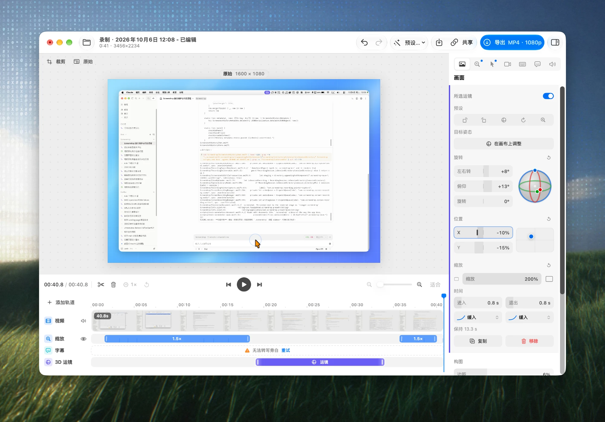

<div align="center">

**English** · [简体中文](README.zh-CN.md)



# Framecho

A native macOS app for screenshots, screen recording and editing

Local library · Non-destructive editing · English and Simplified Chinese · Cloud sharing on your own Cloudflare account

[](https://github.com/helson-lin/Framecho/releases/latest)
[](https://github.com/helson-lin/Framecho/actions/workflows/ci.yml)

[](LICENSE)

<p>
  <a href="https://github.com/helson-lin/Framecho/releases/latest/download/Framecho.dmg"></a>
  <a href="https://github.com/helson-lin/Framecho/releases"></a>
  <a href="https://github.com/helson-lin/Framecho/issues"></a>
</p>



</div>

---

- **Requirements**: macOS 15 or later. Release builds run natively on Apple Silicon and Intel. A few features differ on macOS 15; see [On macOS 15](#on-macos-15).
- **Origin**: Framecho started as a fork of [Screendrop](https://github.com/fayazara/Screendrop) and is now maintained independently by [helson-lin](https://github.com/helson-lin), without syncing upstream. It has its own bundle ID, signing, notarization, releases and Sparkle update feed. The GitHub repository was renamed from `helson-lin/Screendrop` to `helson-lin/Framecho`; the old URLs redirect.

> [!NOTE]
> Framecho is under active development. When reporting an issue, please include your macOS version, Framecho version and steps to reproduce.

**Website**: [getframecho.com](https://getframecho.com)

**Contents**: [Install and update](#install-and-update) · [Features](#features) · [Changes from Screendrop](#changes-from-screendrop) · [Shortcuts](#default-shortcuts) · [Privacy and permissions](#privacy-and-permissions) · [Wallpaper packs](#wallpaper-packs) · [Cloud sharing](#cloud-sharing) · [Development](#development) · [Credits and license](#credits-and-license)

## Install and update

1. Download the latest [`Framecho.dmg`](https://github.com/helson-lin/Framecho/releases/latest/download/Framecho.dmg).
2. Open the DMG and drag **Framecho** into Applications.
3. Launch Framecho and grant Screen Recording permission when asked.

A normal launch opens the Library; capture and recording are also available from the menu bar. When launched at login, Framecho stays in the menu bar. Release builds are signed with Developer ID and notarized by Apple.

**Automatic updates**: Framecho checks for updates with Sparkle. The feed is [`appcast.xml`](https://raw.githubusercontent.com/helson-lin/Framecho/main/appcast.xml) on this repository's `main` branch, and DMGs are attached to GitHub releases. You won't be prompted if you're up to date; Debug builds don't check for updates.

**Upgrading from older versions**: `.screendrop` edit files and `.screendroprec` recording projects saved by early versions are renamed to `.framecho` and `.framechorec` at launch. Your library and edits are kept.

### On macOS 15

Everything works on macOS 15, but a few features rely on frameworks introduced in macOS 26 and behave differently:

- **Caption transcription and teleprompter tracking** use the previous generation of on-device speech recognition. Accuracy and word timings are lower than on macOS 26, so cuts made by editing text may need fine-tuning. Speech Recognition permission is requested on first use, and only languages enabled under System Settings → Keyboard → Dictation are recognized.
- **AI caption cleanup**: Apple Intelligence requires macOS 26; you can use an OpenAI-compatible API instead.
- **Appearance**: the editor toolbar, recording controls and pinned-screenshot buttons use macOS 15's translucent materials instead of Liquid Glass.

### Where data lives and uninstalling

| Location | Contents |
| --- | --- |
| `~/Library/Application Support/Framecho/` | The library: screenshots (`History/`), recording projects (`Recordings/`), wallpapers (`Wallpapers/`) and `history.json` |
| `~/Pictures/Framecho/` | Default export folder (configurable in Settings) |
| `com.jarinhe.Framecho` in the Keychain | Upload token for cloud sharing |

To back up, copy the whole `Application Support/Framecho` folder. To uninstall, quit Framecho, delete the app, and optionally delete the folders and Keychain item above. Settings are stored in `~/Library/Preferences/com.jarinhe.Framecho.plist`.

## Features

### Screenshots

- Full-screen, window and area capture; press Space while selecting an area to switch to window capture.
- Timed capture, window shadows, PNG / JPEG export and a custom save folder.
- On-device OCR: select an area of the screen to recognize and copy its text without saving a screenshot.
- A floating preview card with adjustable size, position and action order: copy, save, compress, edit, upload, pin and delete.
- Pin screenshots on screen: pin an area right after selecting it, or pin the most recent screenshot; scroll over a pinned window to change its opacity.

### Library

- Screenshots, videos and editable recording projects in one place, with search, sorting, grid / list views and batch actions.
- Images opened from Finder are imported as copies, so the originals stay untouched.



### Image editor

- **Annotations**: rectangle, ellipse, arrow, line, freehand, text, numbered steps and highlight. Tools live in a floating toolbar above the canvas, each with a single-key shortcut.
- **Done and Copy**: Done saves and closes; Copy copies the current image, including unsaved changes. Save, Save As and Upload are in the Share menu.
- **Redaction**: blur, pixelate, and automatic detection and redaction of sensitive text.
- **Non-destructive**: crop, undo and redo; the original image and a `.framecho` edit sidecar are kept so you can edit again at any time.
- **Backgrounds**: solid colors, gradients, your own wallpapers and downloadable wallpaper packs, with padding, corner radius, shadow, border, watermark and canvas aspect ratio.
- **Effects**: 3D perspective (camera angle, framing, card rotation) and progressive blur.
- **Presets**: import and export `.framechopreset` background presets (older `.screendroppreset` files still import). Local wallpaper files are not included in exported presets.

The sidebar has two tabs by scope. Choosing a tool or selecting an annotation switches back to Annotate automatically.



| Tab | Contents |
| --- | --- |
| Annotate | Tools, style, auto-redaction |
| Canvas | Presets, layout, background, screenshot appearance (corners, shadow, border), 3D perspective, progressive blur, watermark |

### Screen recording

- Record a display, window or area, optionally with camera, microphone and system audio.
- Pause, resume and restart; screen and camera are saved as separate tracks.
- A teleprompter that can follow your speech using on-device speech recognition.

### Studio video editor

- **Editing**: split, trim and delete clips on the timeline, and change playback speed.
- **Camera work**: automatic / manual zoom, cursor following, a rebuilt cursor, click effects and keystroke overlays.
- **3D motion**: set a base pose for the video card and add pose changes with enter / exit transitions on the timeline. Adjust them directly on the canvas with a rotation ball, or drag out a range on the motion track to add one. Exports include motion blur.
- **Camera overlay**: position, size and corner radius, with saved background and layout presets.
- **Captions**: on-device transcription, caption editing, word-by-word highlighting, and cutting the video by editing its text.
- **Export**: original, landscape, portrait and square formats, with a separate crop; quality, codec, resolution, 30 / 60 fps, motion blur and audio settings. Export and sharing use the project's edits, with progress and cancellation.

The sidebar has one icon tab per effect; tabs for effects that are active in the frame show a small dot. When you select a zoom, motion or clip on the timeline, its settings appear at the top of the sidebar, so you don't have to switch tabs.



| Tab | Contents |
| --- | --- |
| Canvas | Layout, background, video card |
| Zoom & 3D Motion | Zooms, 3D motion |
| Cursor | Show or hide, size, click highlights |
| Camera | Position, size and corner radius of the camera overlay |
| Keystrokes | Keystroke overlays |
| Captions | Captions, editing by text |
| Images | Image overlays such as a logo, QR code or screenshot |
| Intro & Outro | Intro and outro cards |
| Audio | Volume, replacing or adding audio files |

Numeric fields in both editors can be dragged or clicked to a position, and a fill bar shows where the value sits in its range. Hold <kbd>Option</kbd> while dragging for fine adjustment, press <kbd>Shift</kbd> + arrow keys to step by 10%, or click the value to type it.

### Sharing and automation

- Share screenshots and videos through your own Cloudflare Workers, R2 and D1.
- Video share pages include a player, scrubbing previews, a searchable transcript and comments.
- Separate after-capture actions for screenshots and recordings: auto-save, copy, upload and open in the editor. Uploading and copying the link after upload are configured separately.
- Shortcuts, Siri and App Intents support.
- **AI agents (MCP)**: turn on agent access under Settings › AI, and clients such as Claude Code, Claude Desktop and Cursor can connect with `Framecho --mcp` to transcribe a recording, cut it by its words, add zooms and intro or outro cards, and export it. Every edit is non-destructive and can be undone in Studio. Agent access is off by default.

## Changes from Screendrop

Framecho is based on [Screendrop](https://github.com/fayazara/Screendrop) v0.34.0 (October 1, 2026), plus a few upstream PRs merged after it. This section lists only what was added or changed since Framecho became independent; features that already existed upstream (Metal motion blur, 30 / 60 fps export, pinning, OCR, smart redaction and so on) are not included.

**Chinese support**
- A complete Simplified Chinese interface; all UI text is localized through String Catalogs.
- OCR and auto-redaction recognize Chinese: the language is detected per image, CJK text mixed into mostly English lines is read, large screenshots are recognized in tiles, and copied text keeps its layout.

**Editors**
- 3D motion for video: add pose changes with transitions to the video card on the timeline, adjust them on the canvas with a rotation ball, and export with motion blur.
- The image editor's tools moved to a floating toolbar above the canvas, each with a single-key shortcut; the title bar now has Done and Copy, plus undo / redo buttons.
- Both editors' sidebars are split into tabs by purpose (image: Annotate / Canvas; Studio: one tab per effect) and switch automatically when you select something; numeric fields became sliders you can drag or click to a position.

**Pinned screenshots**
- New shortcuts for "Capture Area and Pin" and "Pin Latest Screenshot".
- Select, move and annotate directly in a pinned window; zoom with keys, trackpad pinch or <kbd>⌘</kbd> + scroll; see and adjust opacity; Live Text support.

**Recording**
- Live microphone levels in the recording picker and while recording; press the recording shortcut again to stop; confirmation before discarding or restarting a recording.
- The screen is captured as 4:2:0 instead of BGRA (1.5 bytes per pixel instead of 4), and the camera records at 720p 4:2:0; unchanged cursor images are no longer re-encoded.

**Library, settings and onboarding**
- A redesigned Library: smart groups in the sidebar, items grouped by date, adjustable grid thumbnail size, and sortable list columns.
- Settings grouped by category, with a dedicated Shortcuts page; the menu bar menu shows capture shortcuts.
- A first-run guide that shows the live status of each permission; it opens automatically when a capture is missing Screen Recording permission.

**Performance and reliability**
- Copying to the clipboard, generating preview thumbnails and lossy auto-save run off the main thread; new screenshots are moved into History instead of copied; cloud uploads stream from disk.
- Edited, cropped and compressed images keep their original DPI.
- If `history.json` is partly corrupted, readable entries are kept and the unreadable part is backed up.
- Fixed video export rendering on Intel Macs.

**Sharing**
- Screenshots are uploaded as AVIF with a JPEG preview.
- The companion Worker is maintained by this project: [Framecho-worker](https://github.com/helson-lin/Framecho-worker).

**Engineering**
- Separate signing, notarization and Sparkle update feed.
- CI and a set of standalone check scripts; the release tool refuses to release when checks or CI fail.

## Default shortcuts

| Shortcut | Action |
| --- | --- |
| <kbd>⌥</kbd> <kbd>1</kbd> | Capture full screen |
| <kbd>⌥</kbd> <kbd>2</kbd> | Capture window |
| <kbd>⌥</kbd> <kbd>3</kbd> | Capture area |
| <kbd>⌥</kbd> <kbd>4</kbd> | Open the recording picker |
| <kbd>⌥</kbd> <kbd>5</kbd> | Recognize and copy text on screen |
| <kbd>⌥</kbd> <kbd>6</kbd> | Capture after a countdown |
| <kbd>⌥</kbd> <kbd>7</kbd> | Capture Area and Pin |
| <kbd>⌥</kbd> <kbd>8</kbd> | Pin Latest Screenshot |
| <kbd>⌘</kbd> <kbd>⇧</kbd> <kbd>L</kbd> | Open the Library |

All eight global shortcuts can be changed in Settings; the Library shortcut is fixed. If a new shortcut can't be registered, Framecho keeps the previous working one and explains why.

In the image editor (except while editing text):

| Shortcut | Action |
| --- | --- |
| <kbd>H</kbd> Select · <kbd>R</kbd> Rectangle · <kbd>⇧</kbd> <kbd>R</kbd> Filled rectangle · <kbd>O</kbd> Ellipse · <kbd>L</kbd> Line · <kbd>A</kbd> Arrow · <kbd>F</kbd> Freehand | Shapes and lines |
| <kbd>N</kbd> (or <kbd>1</kbd>) Number · <kbd>T</kbd> Text · <kbd>S</kbd> Highlight · <kbd>P</kbd> Pixelate · <kbd>B</kbd> Blur | Numbers, text and redaction |
| <kbd>⌘</kbd> <kbd>C</kbd> | Copy the current image |
| <kbd>⌘</kbd> <kbd>↩</kbd> | Done (save and close) |
| <kbd>⌘</kbd> <kbd>S</kbd> / <kbd>⇧</kbd> <kbd>⌘</kbd> <kbd>S</kbd> | Save / Save As |
| <kbd>⇧</kbd> <kbd>⌘</kbd> <kbd>C</kbd> | Crop |
| <kbd>⌘</kbd> <kbd>Z</kbd> / <kbd>⇧</kbd> <kbd>⌘</kbd> <kbd>Z</kbd> | Undo / Redo |
| <kbd>⌘</kbd> <kbd>1</kbd> / <kbd>⌘</kbd> <kbd>0</kbd> | Zoom to fit / Actual size |

## Privacy and permissions

Screenshots, raw recording tracks, edit projects and transcripts are stored locally on your Mac. Speech transcription runs on device; the system may download a language model on first use. On macOS 15 it uses the system's on-device dictation model and likewise never falls back to server recognition. Files are sent only to the service you configured, and only when you upload manually or have turned on automatic upload.

| Permission | Used for |
| --- | --- |
| Screen & System Audio Recording | Screenshots, screen recording and system audio |
| Camera | Camera preview and a separate camera track |
| Microphone | Narration and teleprompter speech tracking |
| Speech Recognition (macOS 15 only) | Caption transcription and teleprompter speech tracking |
| Input Monitoring | Editable keystroke overlays |

Camera, microphone, speech recognition and input monitoring are requested only when you use the related feature. Speech recognition is requested when you turn on the teleprompter or transcribe for the first time, never in the middle of a recording. Framecho's own windows are excluded from captures by default; to record the preview card, controls or settings, turn on "Include Framecho windows in captures" in General settings.

## Wallpaper packs

Wallpaper packs are downloaded when you install them and stored in `~/Library/Application Support/Framecho/Wallpapers/`. Both the image and video editors can use them, and you can also pick any image of your own as a background.

| Pack ID | Pack | Author | Images | Download |
| --- | --- | --- | --- | --- |
| `uihssn` | UIHSSN | [Ahmed Hassan](https://x.com/uihssn) | 12 | [uihssn-wallpaper-pack.zip](https://r2.jarin.me/Frameecho/uihssn-wallpaper-pack.zip) |
| `fayaz` | Fayazara | [Fayaz Ahmed](https://x.com/fayazara) | 5 | [fayaz-wallpaper-pack.zip](https://r2.jarin.me/Frameecho/fayaz-wallpaper-pack.zip) |

If a download fails, installed wallpapers, solid colors, gradients and custom images remain available. The wallpapers come from Screendrop's wallpaper packs and are copyrighted by their authors; this repository's CC0 license does not apply to them. See [Wallpaper hosting](docs/wallpaper-hosting.md) for hosting details.

## Cloud sharing

Framecho has no public upload server; cloud sharing is deployed to your own Cloudflare account. The companion service is maintained by this project: [Framecho-worker](https://github.com/helson-lin/Framecho-worker). Screenshot and recording sharing uses Workers + R2 + D1; the wallpaper bucket can be used on its own.

1. Open **Settings → Cloud** and copy the generated upload token.
2. Deploy the Worker to your Cloudflare account from the deploy link in Settings.
3. Set the upload token as the Worker's `UPLOAD_TOKEN` secret and finish the R2 / D1 bindings.
4. Paste the Worker URL into Framecho, verify the connection, and start uploading.

When deploying manually, set the token with Wrangler:

```bash
npx wrangler secret put UPLOAD_TOKEN
```

The first deployment only needs `UPLOAD_TOKEN`; GitHub / Google OAuth for comments and likes can be added afterwards. The upload token is stored in the macOS Keychain.

## Development

### Build from source

Building requires Xcode 27.1 (the version used for releases and CI); the app runs on macOS 15 and later. Xcode resolves the Sparkle and DockProgress dependencies automatically.

```bash
git clone https://github.com/helson-lin/Framecho.git
cd Framecho

DEVELOPER_DIR=/Applications/Xcode.app/Contents/Developer xcodebuild build \
  -project Framecho.xcodeproj \
  -scheme Framecho \
  -configuration Debug \
  -destination "platform=macOS"
```

> [!TIP]
> - Studio's motion blur uses a Metal shader. If the build reports a missing Metal Toolchain, run `xcodebuild -downloadComponent MetalToolchain` first.
> - Signing is configured for the maintainer's Apple developer team. Switch to your own team in Xcode, or append `CODE_SIGNING_ALLOWED=NO` to the command for a local compile check; such builds are not for distribution.

The project is `Framecho.xcodeproj`, the app is `Framecho.app`, and the bundle ID is `com.jarinhe.Framecho`. There are three shared schemes: `Framecho`; `Framecho Dev`, which builds a separate `Framecho Dev.app` (bundle ID `com.jarinhe.Framecho.dev`) that can be installed alongside the release; and `Framecho Demo`, which launches with `--demo-mode`.

### Automated checks

There is no Xcode test target. The standalone checks in `scripts/` compile the production code they exercise and run it, without launching the app:

```bash
scripts/run-checks.sh
```

Tests for the release tool:

```bash
go test ./cmd/...
```

Every new `scripts/check-*.swift` must be run by `run-checks.sh` or listed in its `not_run`, or the script fails. Logic that needs checking should live in files that compile without the app.

For performance checks, see [Video export performance](docs/export-performance.md) and [Editor performance](docs/editor-performance.md).

[GitHub Actions](.github/workflows/ci.yml) runs on every pull request and push to `main`; pushes that only touch `appcast.xml`, docs, Markdown or `website/` are skipped.

| Check | What it does |
| --- | --- |
| Build app | Unsigned Debug build with Xcode 27.1 on GitHub's `xcode-27` image |
| Standalone checks | Runs `scripts/run-checks.sh` |
| Release tool | `go vet` and `go test` for the release tool on Linux |

The `xcode-27` image is still in beta; when GitHub changes the Xcode versions it ships, the workflow needs updating.

See [docs/releasing.md](docs/releasing.md) for the release process.

## Credits and license

Thanks to [Screendrop](https://github.com/fayazara/Screendrop) and its contributors for the foundation of this project. Framecho is released and maintained in this repository; please file issues at [Framecho Issues](https://github.com/helson-lin/Framecho/issues).

This repository remains under [CC0 1.0 Universal](LICENSE). External wallpapers, third-party dependencies and the cloud Worker have their own licenses; this repository's license does not automatically apply to them.
